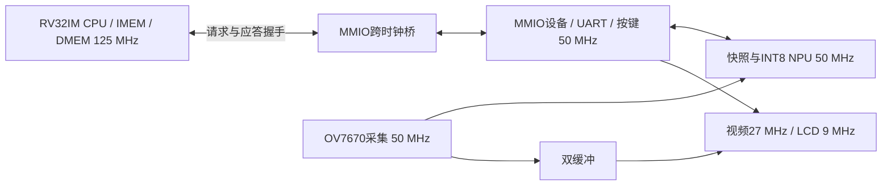

# CPU 125 MHz / NPU 50 MHz 时钟解耦

目标器件为PG2L100H / -6 / FBG676，所有活动RTL继续使用Verilog-2005。本轮目标为CPU、IMEM、DMEM和寄存器堆125 MHz；NPU、摄像头采集、快照、UART、按键和MMIO设备50 MHz；视频27 MHz、LCD像素9 MHz。当前最终布局布线及下载状态以 `build/j11/build_summary.json` 和 `validation/hardware_summary.json` 为准，PLL仿真通过本身不代表125 MHz时序收敛或实际运行已验证。

2026-11-02 22:46:59已完成三模式版本的原生综合、布局布线和位流生成，详细时序CPU建立WNS为+0.553 ns、50 MHz域为+7.006 ns，所有约束通过；映射LUT4469、FF3706、APM10、DRM64。七项定向检查通过，包括两种手势类别头文件的实际固件测试、Verilog、核验状态机、主机工具、LCD及两套实际RV32整机；模式测试新增去抖按键的完整三模式循环、忙时取消和COCO80未部署互锁，源码及暂存RTL/固件/模型哈希在测试前后保持一致。当前位流SHA256为 `0b3b59514c567ab5c313c3f858d7659f19aaf005ab8c7cebcca95e7adaf78baa`，报告见 `validation/three_modes/summary.json`。

首次时钟拆分版本的15项完整回归及22:15下载失败记录保存在 `validation/hardware_20261102/cpu125_npu50_20261102_220034/`，其中位流和时序属于该次旧版。后续三模式位流、测试和JTAG状态统一见 `MODES.md`、`BOARD_VALIDATION.md` 与 `validation/hardware_summary.json`，证据目录由 `validation/latest_three_mode_attempt.txt` 指向。配置成功也不代替应用运行和实际时钟测量验收。

## 处理器与外设接口

`vision_mmio_bridge.v`采用一个未完成事务的请求/应答翻转位握手。CPU锁存读写方向、地址、数据和字节选通，等待50 MHz端处理后返回；每个事务只在外设域产生一个周期的读或写脉冲。请求和返回数据保持到跨域确认，翻转位经过两级同步；约束仅对同步器首级和复位异步端放宽，保留CPU内部8 ns时序约束，并给保持的数据路径独立最大延迟。

CPU新增外部访问等待信号，只有访问MMIO时停顿流水线，IMEM和DMEM仍在CPU域直接访问。等待期间保持LSU的访问状态、读数据选择和上一条指令写回数据，避免慢速应答破坏前一条加载或重发有副作用的写入。NPU可在CPU执行其他指令时继续运行；CPU与NPU频率比例不再要求相同。

50 MHz自由运行计时器仍位于MMIO域。固件的`CLOCK_HZ`继续表示这个计时基准；新增`CPU_CLOCK_HZ`为125 MHz，`NPU_CLOCK_HZ`为50 MHz。超时、UART、去抖和NPU周期换算不随CPU提频误放大。CoreMark后续固件分别输出计时器和CPU频率，按CPU频率计算每MHz成绩；旧成绩文件没有改写，也没有要求重跑。

## 为125 MHz做的实现调整

第一轮实际布局布线发现寄存器堆被映射到块RAM，其输出经过转发和ALU成为关键路径；使用PDS ADS手册支持的`syn_ramstyle="select_ram"`让32×32寄存器堆使用分布式RAM。

随后关键路径转到32×32乘法的DSP级联。乘法改为四个17位有符号部分积，再分级合成低位和高位，覆盖MUL、MULH、MULHSU和MULHU；控制逻辑等待三个计算周期再交付结果。除法算法保持原实现。乘法延迟变化应以实际应用和后续真实跑分评估，不能仅按频率比例推算性能。

## 验证与证据

- `sim/tb_muldiv.v`：2560组RV32M边界和随机输入，检查有符号、无符号、混合符号高位、除零和溢出结果。
- `sim/test_cpu_mmio.py`：执行真实RV32程序，在125 MHz CPU与非整数相位的约48 MHz测试外设之间完成512组相关加载/存储、字节写、局部RAM访问和副作用次数核对；测试外设使用20.74 ns周期以覆盖不同相位，不表示板上外设改为该频率。
- `sim/tb_soc.v`：125/50 MHz两个时钟执行真实标签和手势固件，检查RGB565快照、INT8结果、UART、模式切换和帧边界显示。
- `sim/tb_board.v`：使用Pango GPLL仿真模型检查CPU125 MHz、视频27 MHz、LCD9 MHz、相机12.5 MHz以及复位重新锁定。
- 原生构建同时要求布局布线摘要无违例、详细时序报告无VIOLATED路径，并产生新的位流。失败尝试保存在 `validation/clock_split_125m/attempt_01/` 和 `attempt_02/`，未下载失败位流。

NPU仍为每次1769238周期，50 MHz纯计算约35.38 ms。CPU提频不会缩短该计算，也不能代替端到端帧率、识别准确率和温度稳定性实测。COCO80模型所需的不同网络和存储设计见 `model/COCO80_FEASIBILITY.md`。
